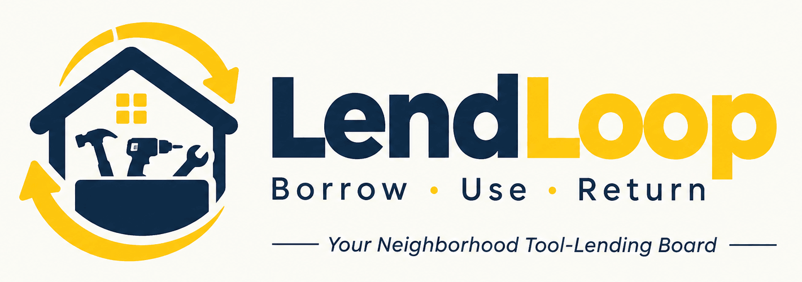

<p align="center"></p>

# LendLoop

**Borrow what you need. Lend what you don't.**

A neighborhood tool-lending board. Neighbors list tools, request to borrow them for a date range, and
get automated notifications and overdue reminders through n8n.

| Layer      | Choice                                                        |
| ---------- | ------------------------------------------------------------- |
| Frontend   | Next.js 16 (App Router), React 19, Tailwind CSS 4, TypeScript |
| Auth       | Clerk (JWT verified by Convex)                                |
| Data/API   | Convex (queries, mutations, scheduled actions, HTTP actions)  |
| Automation | n8n 2.x (self-hosted via Docker Compose)                      |
| Quality    | Vitest + convex-test, ESLint, Prettier, GitHub Actions CI     |

See [`docs/architecture.md`](docs/architecture.md) for diagrams and the design decisions behind them.

---

## Features

- **Public page:** tagline, plus a live pegboard of _available_ tools showing only name and category,
  with no owner details. "Sign in to lend or borrow" opens Clerk.
- **Board:** every tool with its availability (available, on loan until a date, or overdue),
  category filter, search, and a "Needs you" strip for pending actions.
- **Listings:** create, edit and delete your own tools (name, category, condition, description).
- **Borrowing:** pick dates on a calendar that hatches out booked days. Overlaps, past dates, loans
  longer than 14 days and requests more than 90 days ahead are rejected server-side.
- **Lending:** approve or decline incoming requests. Approving declines overlapping competing
  requests automatically. Mark a loan returned.
- **Views:** _My listings_, _My requests_ and _Incoming requests_, each loan shown with its journey and
  **automation activity** ("Overdue reminder sent via log, 2 days ago").
- **Admin:** remove any listing, view all loans, mark Trusted Lenders, and inspect or retry failed
  automations.

## Roles and access control

| Capability                                            | user              | admin |
| ----------------------------------------------------- | ----------------- | ----- |
| Browse board, request to borrow                       | ✅                | ✅    |
| Create / edit / delete a listing                      | own only          | own   |
| Approve, decline, mark returned                       | own tools only    | own   |
| Cancel a request                                      | own requests only | own   |
| Remove any listing                                    | ❌                | ✅    |
| View all loans, set Trusted Lender, retry automations | ❌                | ✅    |

Enforcement lives **in Convex**, not the UI:

- Every public function is built from `userQuery` / `userMutation` / `adminQuery` / `adminMutation`
  (`convex/lib/functions.ts`). Authentication and role checks therefore can't be forgotten.
- The role comes from the **verified Clerk JWT** (`role` claim mapped from `publicMetadata.role`). It
  is never read from client arguments, and the copy in the database is only used for display.
- Ownership is checked per action against a declarative table (`LOAN_ACTIONS` in
  `convex/lib/loans.ts`): who may act, and from which state.
- Users who aren't party to a loan get `NOT_FOUND`, not `FORBIDDEN`, so loan IDs can't be probed.
- Integration endpoints and internal functions (`internal.*`) can't be called from the browser.

## Security and data minimization

- **Authentication:** Clerk issues a JWT (template `convex`) that Convex verifies against
  `CLERK_JWT_ISSUER_DOMAIN`. The app layout also calls `auth.protect()`, but the server-side checks
  in Convex are what actually protect the data.
- **Authorization:** role and ownership checks run in Convex on every call (see
  [Roles and access control](#roles-and-access-control)). A direct API call by a regular user to an
  admin function returns `FORBIDDEN`.
- **Least data out:**
  - The public page query returns only `name` and `category` of available tools: no owner,
    condition, description or dates.
  - Neighbors see each other as a name and a Trusted badge. Emails are never sent to another user's
    browser.
  - n8n receives only the recipient's name and email, the tool name and dates for one message.
    Overdue fetches return only loans that are overdue and not yet reminded today.
- **Input validation:** every argument has a Convex validator; text is trimmed and length-capped,
  and date rules are enforced server-side.
- **Integration security:** signed both ways with separate secrets, replay window and fail-closed
  behavior (see [Security, both directions](#security-both-directions)).
- **Secrets:** only in `.env.local`, Convex environment variables, `n8n/.env` and n8n credentials.
  All local env files are gitignored, and workflow JSON reads secrets via `$env` at runtime.

---

## Getting started

### Prerequisites

Node 22, Docker, a [Clerk](https://clerk.com) application, a [Convex](https://convex.dev) account, and
a tunnel (e.g. `ngrok`) so Convex cloud can reach your local n8n.

### 1. Install and start Convex

```bash
npm install
cp .env.example .env.local          # fill the Clerk keys
npx convex dev                      # logs in, creates a deployment, writes NEXT_PUBLIC_CONVEX_URL
```

### 2. Configure Clerk

For a **development** instance, one idempotent script does it all through Clerk's Backend API. It
creates or updates the `convex` JWT template with the claims below and the three e2e users
(`e2e/users.json`; Ama is the admin):

```bash
npm run setup:clerk                 # prints the issuer domain to use next
npx convex env set CLERK_JWT_ISSUER_DOMAIN https://<your-app>.clerk.accounts.dev
```

To configure it by hand instead, create a JWT template named `convex` (or enable the Convex
integration) with these claims:

```json
{
  "aud": "convex",
  "role": "{{user.public_metadata.role}}",
  "email": "{{user.primary_email_address}}",
  "name": "{{user.full_name}}"
}
```

To make someone an admin, set their **public metadata** to `{ "role": "admin" }`. It takes effect on
their next token refresh (sign out and back in).

### 3. Start n8n and connect it

```bash
cp n8n/.env.example n8n/.env        # generate secrets: openssl rand -hex 32
npm run n8n:up                      # n8n on http://localhost:5678
npm run n8n:import                  # imports + publishes the 3 workflows (re-runnable)
npm run tunnel                      # ngrok to n8n, and points Convex's N8N_LOAN_EVENTS_WEBHOOK_URL at it
```

`npm run tunnel` reuses an ngrok tunnel that is already running, so re-run it whenever ngrok
restarts and hands out a new URL. Set `NGROK_DOMAIN=<your-static-domain>.ngrok-free.app` to use
ngrok's free static domain and keep the URL fixed.

Then set the shared secrets on the Convex side. Use the **same** values as `n8n/.env`:

```bash
npx convex env set N8N_WEBHOOK_SECRET <same as n8n/.env>
npx convex env set AUTOMATION_API_SECRET <same as n8n/.env>
```

In `n8n/.env`, set `CONVEX_SITE_URL=https://<deployment>.convex.site` and `WEBHOOK_URL` to the tunnel.

Optional real email: set `LENDLOOP_EMAIL_ENABLED=true` and `LENDLOOP_EMAIL_FROM`, then create a
**Header Auth** credential named `Resend API` in n8n (`Authorization: Bearer re_…`). Otherwise
notifications are delivered to the **log channel**: visible in `docker compose logs n8n` and in each
execution.

### 4. Run the app

```bash
npm run dev                         # http://localhost:3000
npm run seed                        # optional demo neighbors, tools and an overdue loan
```

### Environment variables

| Where                         | Variable                                                         | Purpose                                                     |
| ----------------------------- | ---------------------------------------------------------------- | ----------------------------------------------------------- |
| `.env.local` (Next.js)        | `NEXT_PUBLIC_CONVEX_URL`                                         | Convex client URL                                           |
|                               | `NEXT_PUBLIC_CLERK_PUBLISHABLE_KEY`, `CLERK_SECRET_KEY`          | Clerk keys (secret key is server-only)                      |
|                               | `NEXT_PUBLIC_CLERK_SIGN_IN_URL`, `NEXT_PUBLIC_CLERK_SIGN_UP_URL` | `/sign-in`, `/sign-up`                                      |
|                               | `CONVEX_DEPLOYMENT` or `CONVEX_DEPLOY_KEY`                       | Which Convex deployment the CLI targets                     |
| Convex (`npx convex env set`) | `CLERK_JWT_ISSUER_DOMAIN`                                        | Clerk issuer that Convex trusts                             |
|                               | `N8N_LOAN_EVENTS_WEBHOOK_URL`                                    | n8n webhook for loan events (`npm run tunnel` sets it)      |
|                               | `N8N_WEBHOOK_SECRET`                                             | Signs Convex → n8n requests                                 |
|                               | `AUTOMATION_API_SECRET`                                          | Verifies n8n → Convex requests                              |
| `n8n/.env` (Docker Compose)   | `N8N_ENCRYPTION_KEY`                                             | Encrypts n8n credentials at rest                            |
|                               | `N8N_WEBHOOK_SECRET`, `AUTOMATION_API_SECRET`                    | Same values as in Convex                                    |
|                               | `CONVEX_SITE_URL`                                                | `https://<deployment>.convex.site` for the signed endpoints |
|                               | `WEBHOOK_URL`                                                    | Public base URL n8n advertises (the tunnel)                 |
|                               | `LENDLOOP_EMAIL_ENABLED`, `LENDLOOP_EMAIL_FROM`                  | Optional email; off by default, so notifications are logged |
| Shell (optional)              | `NGROK_DOMAIN`, `E2E_BASE_URL`                                   | Static tunnel domain; base URL for e2e tests                |

Templates: [`.env.example`](.env.example) and [`n8n/.env.example`](n8n/.env.example).

### Useful scripts

| Script                                        | Purpose                                                            |
| --------------------------------------------- | ------------------------------------------------------------------ |
| `npm test`                                    | Convex tests: access control, transitions, signatures, idempotency |
| `npm run test:e2e`                            | Playwright browser tests against the running app (see Testing)     |
| `npm run setup:clerk`                         | Prepare a Clerk dev instance: JWT template and e2e users           |
| `npm run typecheck` / `lint` / `format:check` | Static checks (all run in CI)                                      |
| `npm run n8n:build`                           | Regenerate workflow JSON from `n8n/code/*.js`                      |
| `npm run n8n:check`                           | CI guard: fails if generated workflows drift from their sources    |

---

## Automation with n8n

| Workflow                            | Trigger                                      | What it does                                                                                     |
| ----------------------------------- | -------------------------------------------- | ------------------------------------------------------------------------------------------------ |
| LendLoop · Loan event notifications | Webhook `POST /webhook/lendloop/loan-events` | Verifies signature → dedupes → composes message → email or log → responds with the channel       |
| LendLoop · Overdue reminders        | Daily 08:00 UTC (+ manual trigger)           | Signed `GET /automation/overdue-loans` → reminder per loan → signed `POST /automation/reminders` |
| LendLoop · Error handler            | Error Trigger for both workflows             | Signed `POST /automation/failures` → shown in Admin › Automation                                 |

### Security, both directions

- **HMAC-SHA256** over `${timestamp}.${rawBody}`, sent as `x-lendloop-signature: v1=<hex>` with
  `x-lendloop-timestamp`. Receivers verify against the **raw** body with a constant-time comparison
  and reject anything outside a ±5 minute window, which blocks replays.
- **Separate secrets per direction:** `N8N_WEBHOOK_SECRET` covers Convex → n8n, and
  `AUTOMATION_API_SECRET` covers n8n → Convex. A leaked secret only compromises one direction.
- **Fail closed:** a missing secret returns `503` in Convex or throws in n8n. It never skips
  verification.
- **No secrets in code or workflow JSON:** they live in Convex env vars, `n8n/.env` (gitignored) and
  n8n credentials. Workflows read them via `$env` at runtime.
- **Data minimization:** n8n receives only what one message needs: event type, tool name, dates and a
  single recipient's name and email.

### Reliability

- **Transactional outbox:** a loan state change and its `automationEvents` row are written in the
  same Convex mutation, so a notification can't be lost or sent for a rolled-back change.
- **Retries with backoff:** Convex retries delivery at 10 s → 1 m → 5 m → 30 m (5 attempts). `401`,
  `403` and `422` fail fast because retrying won't fix them. n8n HTTP nodes retry 3× with a 5 s wait.
- **Idempotency:**
  - Each loan event has the key `loan:<id>:<status>`. n8n remembers delivered keys, so Convex retries
    never notify twice.
  - Reminder write-backs are keyed `overdue:<loanId>:<date>`. Retries update rather than duplicate,
    and a `sent` reminder is never downgraded.
  - Loans already reminded today are excluded from the next fetch.
  - Failure reports are deduped per execution.
- **Never silent:**
  - Permanent delivery failures are marked `failed` and listed in Admin › Automation with a Retry
    button.
  - Failed n8n executions trigger the error workflow, which reports them back to Convex.
  - n8n keeps every execution, both successful and failed.

---

## Running in production

What I would change before real neighbors use it:

- **Hosting:** deploy Next.js (e.g. Vercel) and Convex production (`npx convex deploy`) with their
  own env vars, and use a Clerk production instance on the real domain.
- **n8n:** run it on a stable HTTPS domain (n8n Cloud or a managed container) instead of a tunnel,
  with Postgres as its database, queue mode with workers, and a backed-up `N8N_ENCRYPTION_KEY`.
- **Secrets:** keep them in a secrets manager and rotate them. Support two active secrets per
  direction during a rotation so no request fails mid-switch.
- **Notifications:** replace the log channel with a real provider (email from a verified domain, or
  SMS/push), and add per-user notification preferences and unsubscribe.
- **Idempotency at scale:** move n8n's delivered-event memory from workflow static data to a shared
  store (Postgres or Redis).
- **Abuse and scale:** rate-limit requests and listings, and paginate board and admin lists.
- **Observability:** send the error workflow and failed deliveries to an alerting channel (Slack,
  PagerDuty), add error tracking (Sentry) and uptime checks on the webhook and HTTP endpoints.
- **Data lifecycle:** handle Clerk `user.deleted` webhooks to anonymize users, set a retention period
  for loans and automation logs, and send reminders in each user's own timezone.
- **Demo data:** drop the seed function and test accounts from the production deployment.

## Project structure

```
app/                 Next.js routes: public page, sign-in/up, (app)/ authenticated area
components/          ui/ primitives · tools/ · loans/ · layout/
convex/
  lib/               auth + role builders, domain rules, signatures, outbox, HTTP helpers
  tools.ts loans.ts admin.ts users.ts   public API (all role-checked)
  automation.ts http.ts                 outbox delivery + signed endpoints for n8n
  seed.ts                               internal demo data
  tests/                                convex-test suites
n8n/
  code/              Code-node sources (plain JS, reviewed like any code)
  build-workflows.mjs  generates workflows/*.json with stable IDs
  workflows/         exported workflow JSON in n8n's import/export format (generated, no secrets)
docs/architecture.md diagrams and design decisions
```

## Testing

**Unit and integration tests:** `npm test` runs 36 tests against an in-memory Convex backend.

- **Access control:** owners only, admin-only APIs, the role taken from the token.
- **Validation and transitions:** date rules, double-booking, competing requests, invalid state
  changes.
- **Integration:**
  - signature tamper, stale and wrong-secret cases
  - outbox retries, backoff and give-up; dismissing failures
  - signed HTTP endpoints, idempotent write-backs, failure reports, fail-closed configuration

**End-to-end tests:** `npm run test:e2e` drives real browsers through Clerk sign-in against your Convex
deployment. Run it after `npm run setup:clerk`, with `npx convex dev` running.

- **Lending journey:** the lender lists a tool; the borrower finds it and requests it through the
  calendar; the lender approves and marks it returned; the borrower sees the history; the lender
  deletes the listing.
- **Access:** the public page hides owners, signed-out users are redirected, non-admins are refused
  `/admin`, and admins can use every tab.

With n8n running, every loan card also shows the delivered notifications as activity. The workflows
were additionally exercised directly: signed, tampered and replayed webhooks; overdue reminder runs
and re-runs; and error-workflow reporting.
