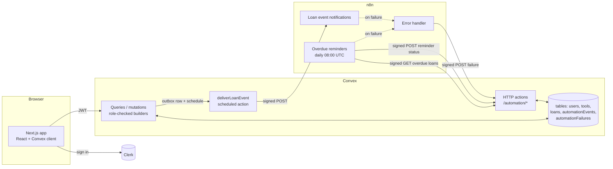
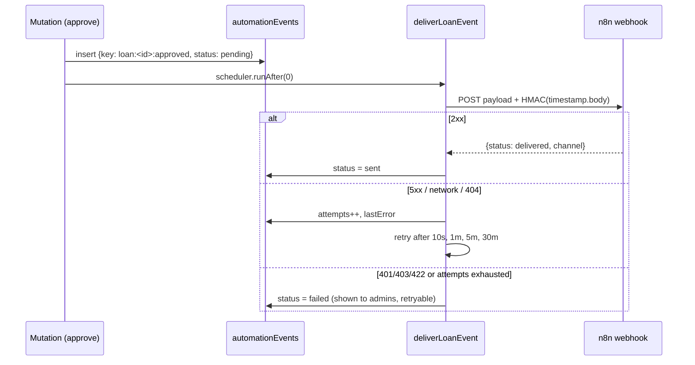

# Architecture

## System overview



## Loan lifecycle

```mermaid
stateDiagram-v2
  [*] --> requested: borrower requests
  requested --> approved: owner approves
  requested --> declined: owner declines / competing approval / listing removed
  requested --> cancelled: borrower cancels
  approved --> returned: owner marks returned
  note right of approved: "overdue" is derived:<br/>approved and endDate < today
```

Every transition goes through `setLoanStatus`, which writes the status, a timestamp and the outbox
event in one transaction. The allowed transitions and the party allowed to perform each one are
declared once in `LOAN_ACTIONS`.

## Notification delivery (Convex → n8n)



## Overdue reminders (n8n → Convex)

1. The schedule fires. n8n signs an empty-body `GET /automation/overdue-loans`.
2. Convex returns approved loans past their end date that haven't had a reminder `sent` today. Each
   comes with a `reminderKey` of `overdue:<loanId>:<date>` and only the borrower's name and email.
3. n8n sends one reminder per loan, either by email or to the log.
4. n8n signs a `POST /automation/reminders` with `{reminderKey, loanId, status, channel}`. Convex
   upserts by `reminderKey`, so a re-run the same day is a no-op.

## Decisions and trade-offs

| Decision                                                       | Why                                                                                                  | Trade-off                                                   |
| -------------------------------------------------------------- | ---------------------------------------------------------------------------------------------------- | ----------------------------------------------------------- |
| Role from the Clerk JWT claim, not the DB                      | Single source of truth; can't be escalated by writing to the DB; revocation applies on token refresh | Role changes need a token refresh                           |
| Custom function builders (`userMutation`, `adminQuery`, …)     | Authorization can't be forgotten; handlers stay focused on domain logic                              | One more abstraction to learn                               |
| Soft-delete listings                                           | Loan history and n8n payloads keep referring to a real tool                                          | Queries filter on `removedAt` (indexed)                     |
| Transactional outbox instead of calling n8n from the mutation  | Mutations can't do I/O; the outbox guarantees at-least-once delivery tied to the commit              | Delivery is asynchronous (sub-second in practice)           |
| At-least-once delivery + idempotency keys on both sides        | Simpler and more robust than exactly-once                                                            | Receivers must dedupe (n8n static data, Convex unique keys) |
| HMAC over raw body + timestamp, separate secrets per direction | Integrity, authenticity and replay protection, with blast radius limited per direction               | Clocks must be within ±5 minutes                            |
| Code-node sources in `n8n/code`, JSON generated                | Reviewable diffs, shared signing snippet (DRY), CI drift check                                       | Edits made in the n8n UI must be ported back to the sources |
| Dates as UTC `YYYY-MM-DD` strings                              | Lexicographic comparison works with indexes; no timezone drift between client, Convex and n8n        | "Today" is UTC for everyone                                 |
| Notifications default to a log channel                         | Works with zero setup and stays fully observable; email is opt-in                                    | Real delivery needs a Resend credential                     |

## Known limitations and next steps

- n8n's delivered-event memory is workflow static data (last 1,000 IDs). At scale, a shared store such
  as Redis or Postgres should replace it.
- Listing queries are capped at 200 rows. A larger neighborhood needs pagination
  (`paginationOptsValidator`).
- No rate limiting on request creation yet (`convex-helpers/server/rateLimit` would fit).
- Pickup isn't tracked separately from approval; "On loan" is derived from the start date.
